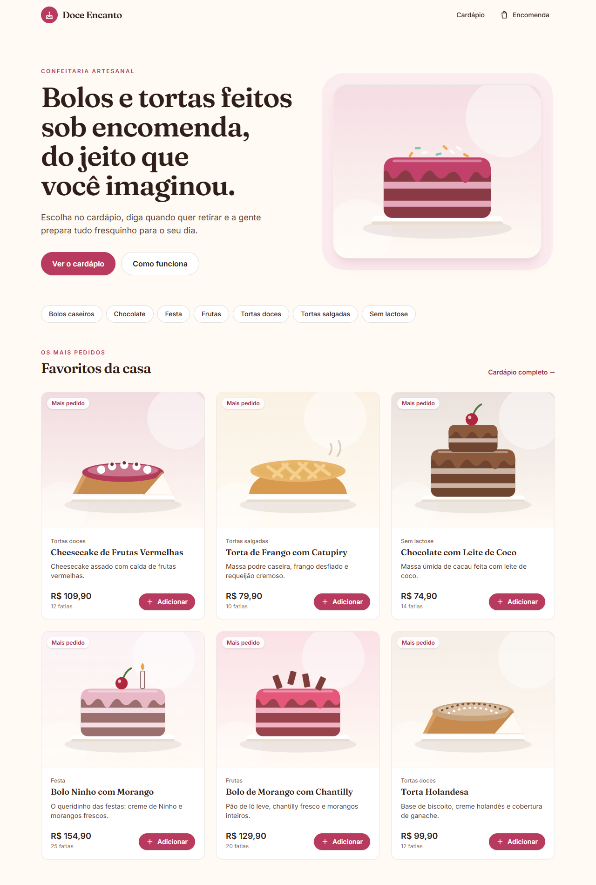
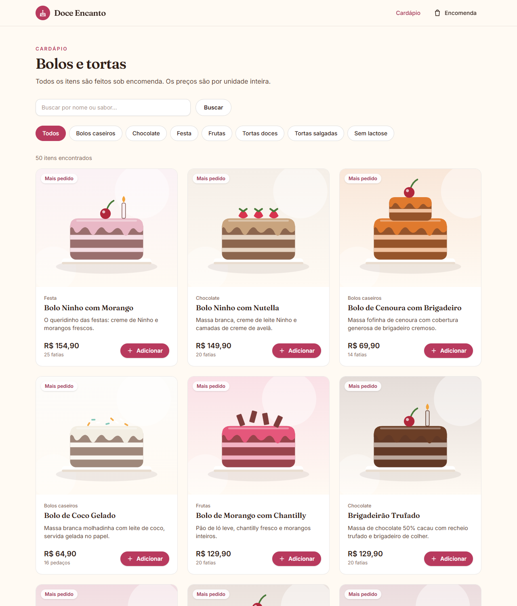
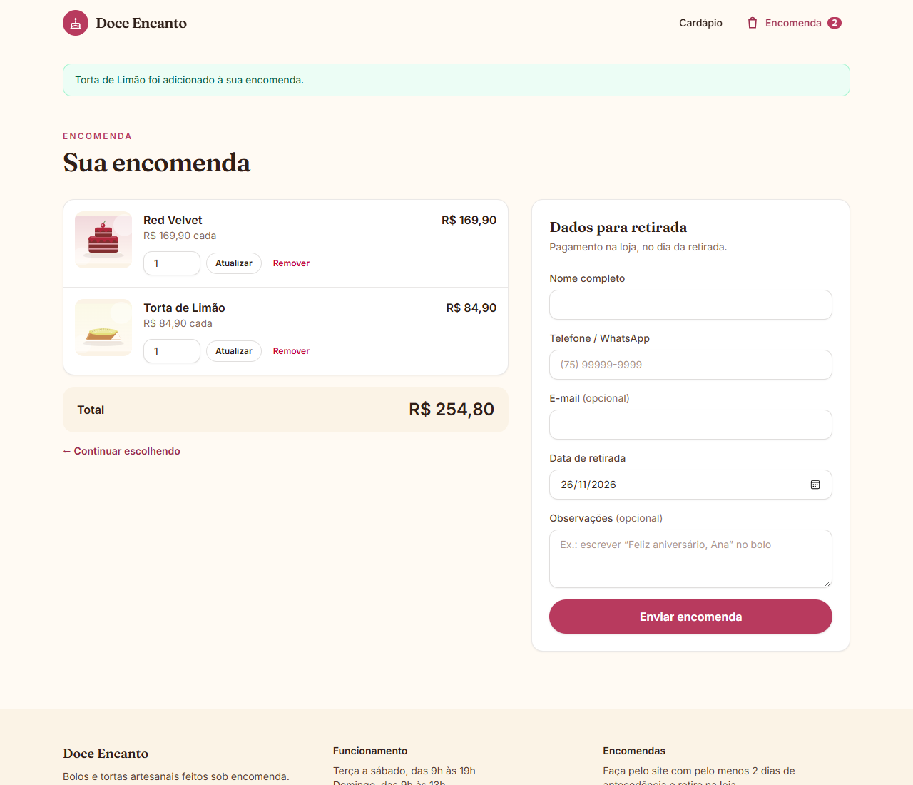
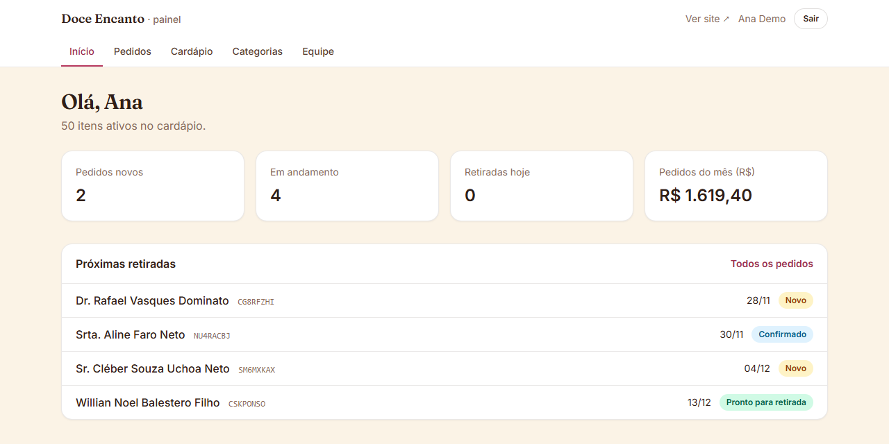

# 🎂 Doce Encanto: Confeitaria em Laravel

Loja virtual de uma confeitaria artesanal feita em **Laravel 13**, com cardápio de 50 bolos e tortas, encomenda online com data de retirada e painel administrativo para a equipe.

> Projeto de portfólio. Clientes, pedidos e a própria confeitaria são fictícios.

<p align="center">
  
</p>

## Funcionalidades

**Site público**
- Cardápio com 50 bolos e tortas em 7 categorias, busca por nome/sabor e paginação
- Página de cada item com preço, rendimento e sugestões da mesma categoria
- Encomenda em carrinho (sessão): quantidade por item, total calculado no servidor
- Pedido com nome, telefone, e-mail opcional, data de retirada (mínimo 2 dias) e observações
- Página de confirmação com código do pedido, acessível só por link assinado
- Ilustrações vetoriais geradas por código para cada item (sem fotos de terceiros); a equipe pode enviar fotos reais

**Painel da equipe** (`/admin`)
- Resumo com pedidos novos, em andamento, retiradas do dia e valor dos pedidos do mês (exceto cancelados)
- Pedidos: filtro e atualização de status (novo, confirmado, pronto para retirada, entregue ou cancelado)
- Cardápio: cadastro, edição, foto (JPG/PNG/WebP até 2 MB), destaque e ocultar item
- Categorias com ordem de exibição (categorias com itens não podem ser excluídas)
- Equipe: apenas administradores cadastram funcionários (e decidem se o novo usuário também é administrador) e removem acessos

| Cardápio | Encomenda | Painel |
|---|---|---|
|  |  |  |

## Segurança

- Sem cadastro público: o primeiro administrador é criado pelo terminal (`php artisan loja:criar-admin`)
- Login com limite de 5 tentativas por e-mail + IP por minuto e 20 por IP; sessão regenerada no login e invalidada no logout (POST)
- Proteção CSRF, escape automático do Blade e consultas pelo Eloquent (sem SQL montado à mão)
- Preços e totais sempre lidos do banco, nunca do formulário; campos extras ignorados (`#[Fillable]`, `is_admin` fora do mass assignment)
- Gate `manage-staff` para gestão da equipe; não é possível excluir a própria conta, e a exclusão roda em transação com bloqueio para nunca remover o último administrador
- Limite de 5 pedidos a cada 10 minutos por IP e chave de idempotência por checkout (envio duplicado abre o mesmo pedido)
- Link de confirmação assinado e válido por 30 dias; códigos inexistentes e links sem assinatura recebem a mesma resposta
- Busca literal (curingas do LIKE escapados) e campos de texto que chegam como lista são ignorados
- Upload validado por tipo real do arquivo, tamanho e dimensões
- `Model::shouldBeStrict()` fora de produção (bloqueia lazy loading e atributos inexistentes)

## Tecnologias

- PHP 8.4.1+ e Laravel 13
- Blade com componentes, Tailwind CSS 4 e Vite (fontes Inter e Fraunces servidas pelo próprio site)
- SQLite por padrão (funciona também com MySQL/MariaDB)
- PHPUnit: 48 testes de recursos, segurança e regras de negócio

## Como executar

Requisitos: PHP 8.4.1+ (extensões `pdo_sqlite` ou `pdo_mysql`, `mbstring`, `fileinfo`), Composer e Node.js 20.19+ ou 22.12+.

```bash
composer install
cp .env.example .env
php artisan key:generate
touch database/database.sqlite          # no Windows: type nul > database\database.sqlite
php artisan migrate --seed              # cria o cardápio de 50 itens e pedidos de exemplo
php artisan storage:link
php artisan loja:criar-admin voce@exemplo.com --nome="Seu Nome"
npm install && npm run build
php artisan serve
```

Acesse `http://localhost:8000` e, para o painel, `http://localhost:8000/entrar`.

Para usar MySQL, ajuste `DB_CONNECTION=mysql` e as variáveis `DB_*` no `.env`.

### Publicar em um servidor

O `.env.example` vem configurado para desenvolvimento. Em produção, use pelo menos:

```dotenv
APP_ENV=production
APP_DEBUG=false
APP_URL=https://seu-dominio
SESSION_SECURE_COOKIE=true
```

Sirva o site somente por HTTPS e rode `php artisan config:cache route:cache view:cache` após cada deploy.

### Testes

```bash
php artisan test
```

## Estrutura

```
app/
  Console/Commands/CreateAdmin.php   comando loja:criar-admin
  Enums/OrderStatus.php              status dos pedidos
  Http/Controllers/                  site (Home, Menu, Cart, Order), login e Admin/*
  Http/Requests/                     validação (pedido, item, categoria, equipe, login)
  Models/                            Category, Cake, Order, OrderItem, User
  Services/Cart.php                  carrinho na sessão
  Support/Money.php                  centavos ⇄ "R$ 1.299,90"
database/seeders/CatalogSeeder.php   cardápio de 50 bolos e tortas
resources/views/components/          layouts, card e ilustração SVG dos itens
tests/                               testes de recursos e unitários
```

## Histórico

A primeira versão deste projeto era PHP puro com MySQL e um template HTML pronto. Esta versão foi reescrita do zero em Laravel, com design próprio, novas funcionalidades e testes.

## Licença

[MIT](LICENSE)
