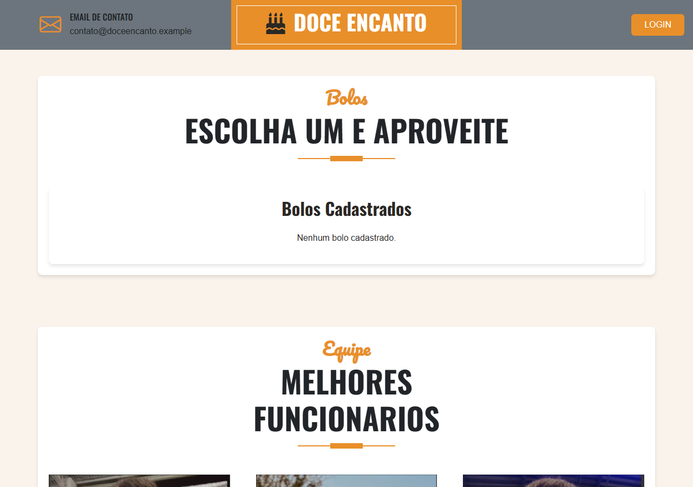

# 🎂 Doce Encanto: Loja de Bolos

Site de uma confeitaria em PHP e MySQL, com vitrine pública de bolos e uma área administrativa onde funcionários cadastram e removem bolos e gerenciam a equipe.

<p align="center">
  
</p>

## Funcionalidades

- Vitrine pública com os bolos cadastrados no banco
- Login de funcionários com senha protegida por `password_hash` (bcrypt)
- Área administrativa para adicionar e excluir bolos e ver a equipe
- Cadastro de funcionários feito só por quem já está logado; o primeiro administrador é criado pela linha de comando

## Segurança

- Toda consulta que recebe dados do usuário usa *prepared statements* (proteção contra SQL injection)
- Toda saída é escapada com `htmlspecialchars` (proteção contra XSS)
- Formulários com token CSRF
- Páginas administrativas exigem sessão ativa; logout só por POST com CSRF e destrói a sessão
- Limite de tentativas de login em janelas de 15 minutos (5 por usuário, 30 por IP), contadas de forma atômica
- Tempo de resposta igual para usuário existente ou não (sem enumeração por tempo)
- Cookie de sessão `Secure` automaticamente quando o site roda em HTTPS
- ID de sessão renovado no login e cookie `HttpOnly`/`SameSite=Lax`
- Mensagem de login genérica, sem revelar se o usuário existe
- URLs de imagem aceitas apenas com `http://` ou `https://`
- Credenciais do banco lidas de variáveis de ambiente

## Tecnologias

- PHP 8 com `mysqli`
- MySQL ou MariaDB
- Bootstrap 5 e o template CakeZone (HTML Codex)

## Como executar

1. Instale o [XAMPP](https://www.apachefriends.org/) (ou Apache + PHP 8 + MySQL).
2. Copie o projeto para a pasta `htdocs`.
3. Crie o banco: `mysql -u root -p < database.sql` (ou importe `database.sql` no phpMyAdmin).
4. Se o seu MySQL não usar `root` sem senha, defina as variáveis `DB_HOST`, `DB_USER`, `DB_PASS` e `DB_NAME`.
5. Crie o primeiro administrador no terminal, na pasta do projeto: `php criar_admin.php admin` (a senha é pedida em seguida).
6. Acesse `http://localhost/loja-de-bolos-php/login.php`. Novos funcionários são cadastrados pelo painel.

## Estrutura

```
config.php          conexão, sessão e funções de segurança (escape, login, CSRF, limite de tentativas)
criar_admin.php     cria o primeiro administrador (só pela linha de comando)
database.sql        estrutura do banco
index.php           vitrine pública
login.php / logout.php / register.php
admin.php           painel (inclui addbolos.php, bolos.php e exibirusuarios.php)
css/ scss/ js/ lib/ img/  arquivos do template
```

## Créditos e licença

O visual é baseado no template gratuito [CakeZone](https://htmlcodex.com/cake-shop-website-template), da [HTML Codex](https://htmlcodex.com), distribuído sob licença Creative Commons Attribution 4.0 (ver [LICENSE.txt](LICENSE.txt) e [READ-ME.txt](READ-ME.txt)).
